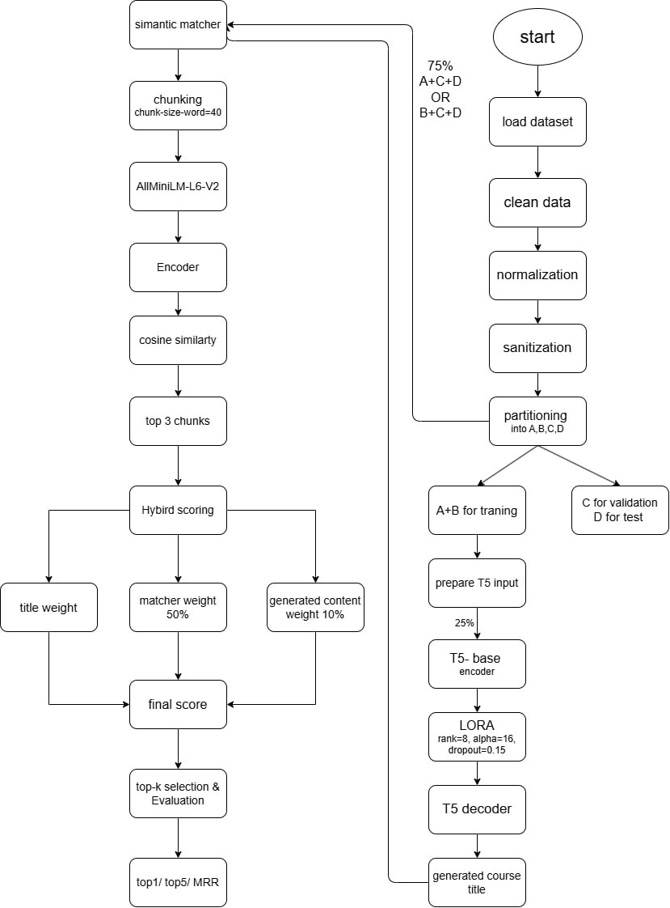
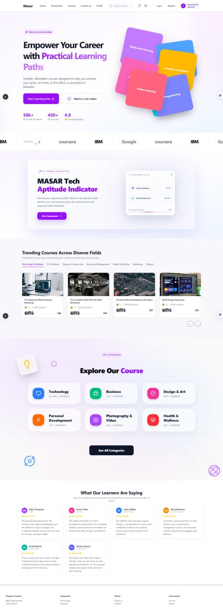
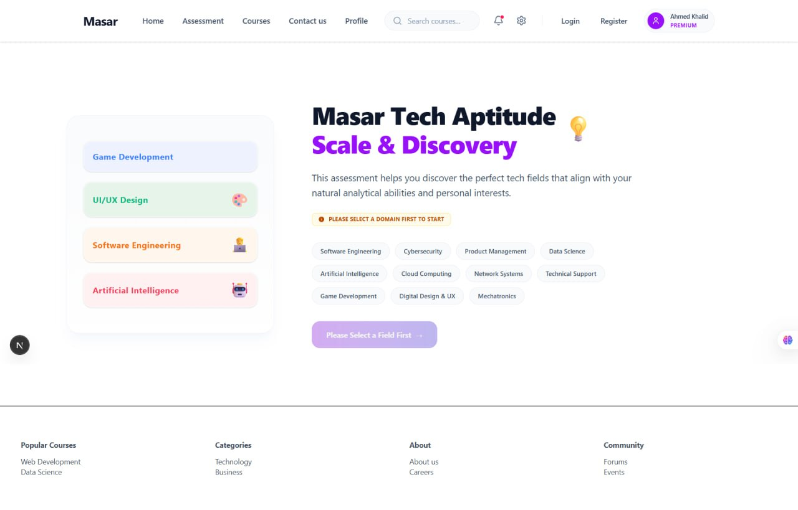
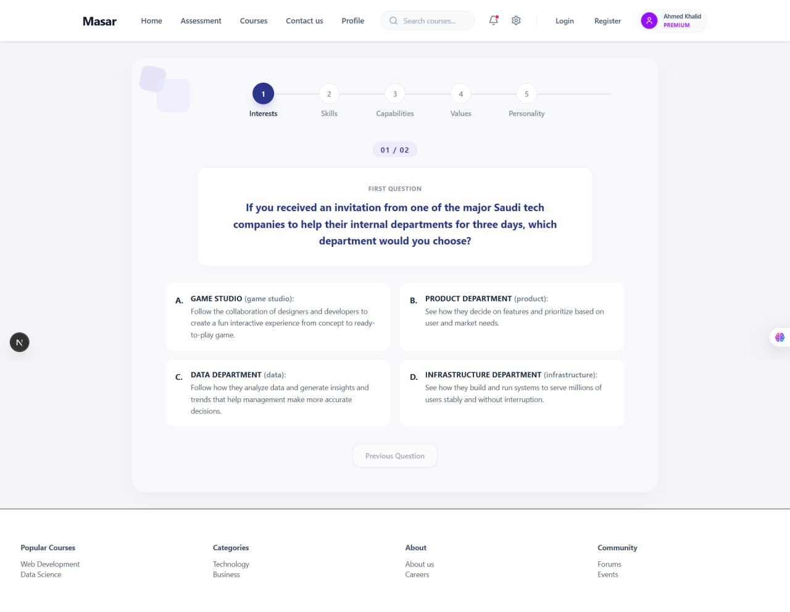

# 🎓 Masar — Smart AI Course Recommendation System
### Full-Stack Frontend & Hybrid NLP Recommendation Pipeline — Graduation Project (5th Year)

**Masar** is an intelligent course recommendation platform that helps students discover tailored tech career paths and matches partial course descriptions to the most relevant courses from a fixed catalog of 1,900 IT courses using a hybrid NLP retrieval pipeline and a modern Next.js interface[cite: 1, 5, 6, 7].

> **Note:** The core AI training and evaluation codebase is kept in a private repository to protect intellectual property, while this repository showcases the system architecture, evaluation methodology, and frontend application[cite: 1, 3].

---

## 🧠 AI System Architecture & Workflow

The recommendation engine combines **conditional title generation** with **chunk-based semantic retrieval**[cite: 1, 3]:

1. **Data Preparation & Leak-Free Partitioning:** Course metadata (syllabus, modules, outcomes, skills, and level) is cleaned, normalized, and split into 4 disjoint partitions (`A, B, C, D`) per course (`A+B` for training, `C` for validation, `D` for testing) to ensure zero data leakage under a fixed-catalog retrieval protocol (not a cold-start / unseen-course test)[cite: 1, 3].
2. **Candidate Title Generation (`T5-base` + `LoRA`):** Fine-tuned using Parameter-Efficient Fine-Tuning (`LoRA`, `r=8`, `alpha=16`, `dropout=0.15`) to generate candidate course titles from partial (25%) course content[cite: 1, 3, 4].
3. **Semantic Retrieval & Hybrid Ranking (`all-MiniLM-L6-v2`):** Encodes generated titles and chunked course documents (`chunk_size = 40` words), averages top-3 chunk cosine similarities, and combines title, matcher, and content scores to evaluate catalog courses via `Top-1`, `Top-5`, `MRR`, and `Semantic Similarity`[cite: 1, 3, 4].

[cite: 3, 8]

---

## 🖥️ Platform UI Showcase

Built with **Next.js, TypeScript, and Tailwind CSS**, the interface guides learners from career discovery to course exploration[cite: 5, 6, 7]:

### Landing & Learning Paths
[cite: 7, 8]

### Tech Aptitude Scale & Domain Discovery
[cite: 6, 8]

### Interactive Career Assessment
[cite: 5, 8]

---

## 🛠️ Tech Stack

### AI & NLP Pipeline
| Component | Technology |
|-----------|-----------|
| Deep Learning & NLP | PyTorch, Hugging Face Transformers (`t5-base`)[cite: 1] |
| Fine-Tuning | PEFT (`LoRA`)[cite: 1] |
| Semantic Search & Embeddings | SentenceTransformers (`all-MiniLM-L6-v2`) with chunking[cite: 1] |
| Data & Evaluation | Pandas, NumPy, Scikit-learn, Matplotlib (`Top-1`, `Top-5`, `MRR`)[cite: 1] |

### Frontend Application
| Layer | Technology |
|-------|-----------|
| Framework | [Next.js 15](https://nextjs.org/) (App Router) |
| Language | TypeScript |
| Styling | Tailwind CSS |
| Font | Geist (via `next/font`) |
| Mock API | JSON Server (`db.json`) |
| Linting | ESLint |

---

## 📁 Project Structure

```text
Graduation_project_5th/
├── assets/               # Architecture diagram & UI screenshots
├── public/               # Static assets (images, icons)
├── src/
│   ├── app/              # Next.js App Router pages & layouts
│   ├── components/       # Reusable UI components
│   ├── lib/              # Utility functions & API helpers
│   └── types/            # TypeScript type definitions
├── db.json               # Mock database for local API (JSON Server)
├── next.config.ts        # Next.js configuration
├── tailwind.config.*     # Tailwind CSS configuration
├── tsconfig.json         # TypeScript configuration
└── eslint.config.mjs     # ESLint configuration
